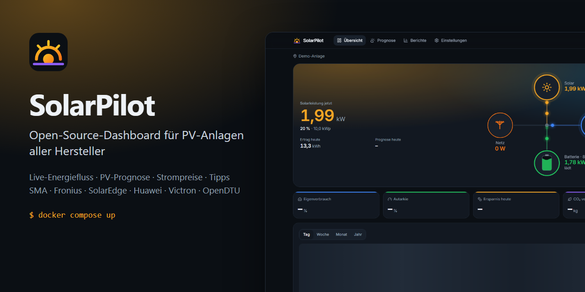
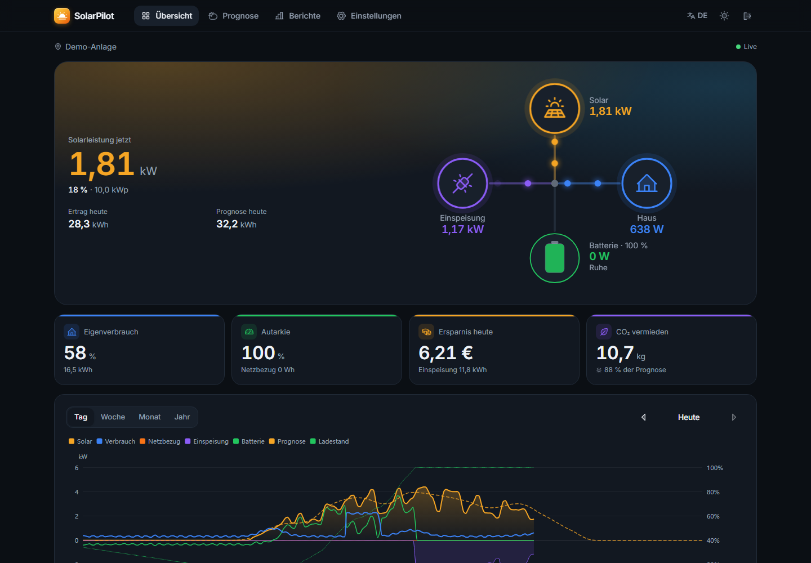
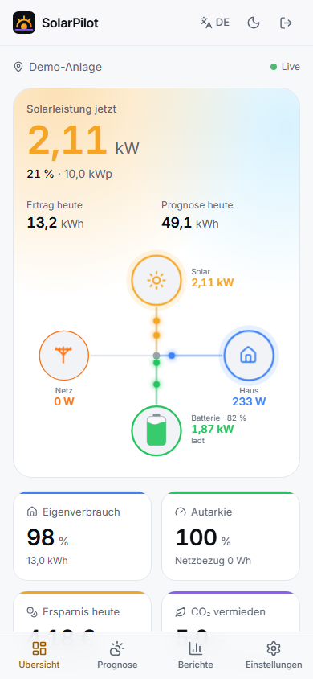
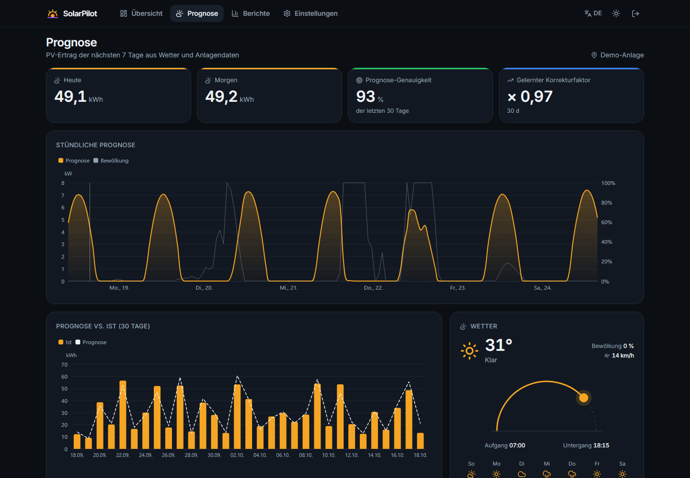
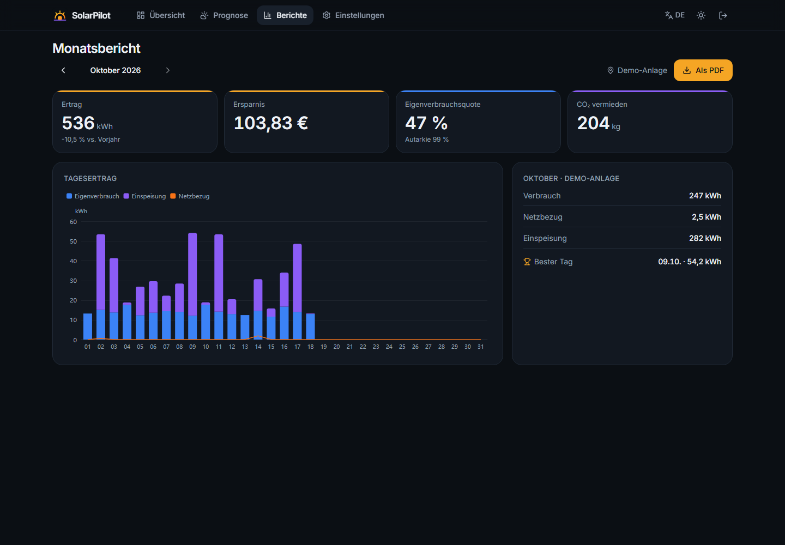
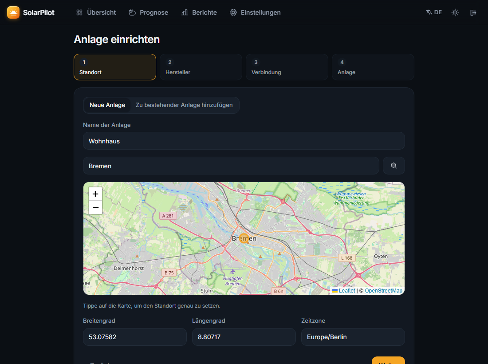
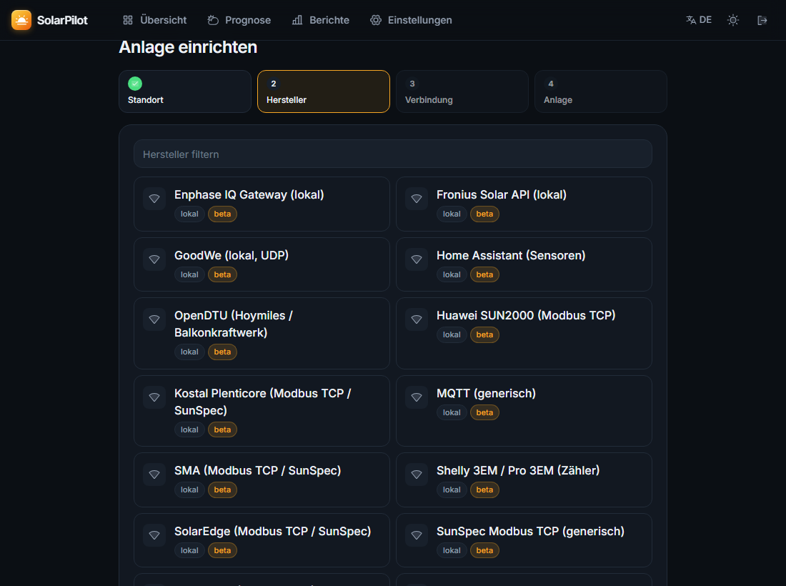
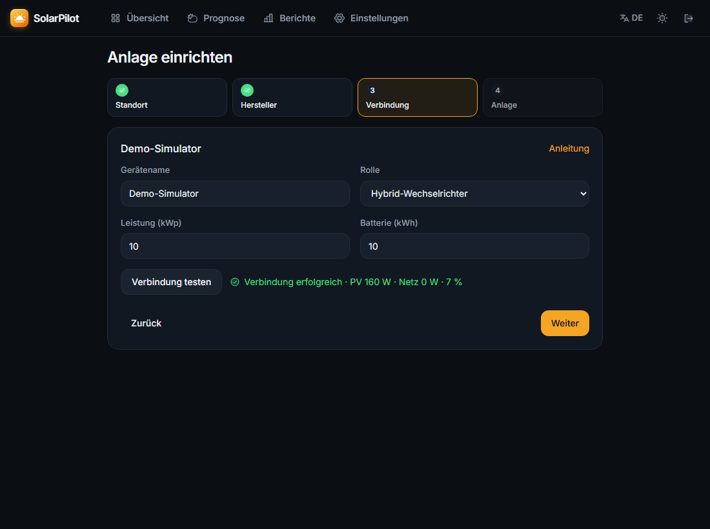
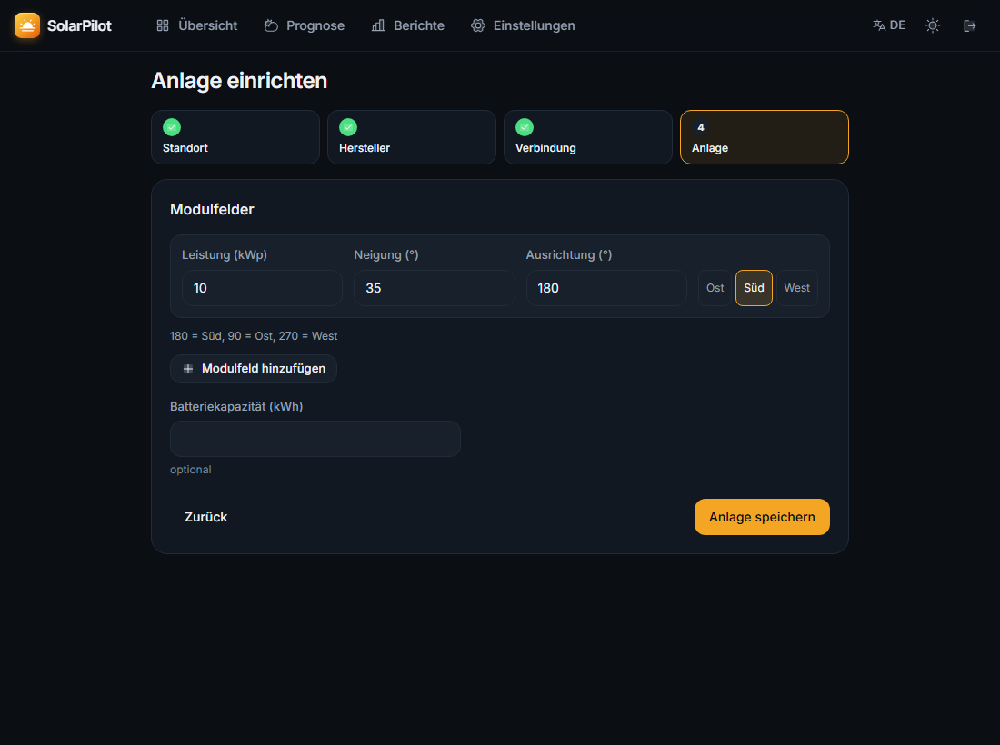

<p align="center">
  
</p>

<h1 align="center">SolarPilot ☀️</h1>

<p align="center">
  <b>Open-Source-Dashboard für PV-Anlagen aller Hersteller</b> – Live-Energiefluss, Wetter, PV-Prognose,
  Strompreise und konkrete Tipps. Selbst gehostet, ohne Cloud-Zwang.
</p>

<p align="center">
  <a href="../../actions/workflows/ci.yml"></a>
  <a href="LICENSE"></a>
  
  
</p>

<p align="center"><a href="#english">English version below</a></p>

---

## Was SolarPilot kann

- ⚡ **Live-Energiefluss** – PV → Haus → Batterie → Netz, animiert, Updates per WebSocket
- 🏠 **Mehrere Anlagen** – beliebig viele Standorte, einzeln oder als Summe „Alle Anlagen“
- 🔌 **Viele Hersteller** – SMA, Fronius, SolarEdge, Kostal, Huawei, Victron, Enphase, GoodWe, OpenDTU (Hoymiles), Shelly, generisch per SunSpec-Modbus, MQTT und Home Assistant
- 🌤️ **Wetter & PV-Prognose** für 7 Tage (Open-Meteo, frei & ohne Schlüssel), Vergleich Prognose vs. Ist, lernender Korrekturfaktor, DWD-Warnungen
- 💶 **Börsenstrompreise** DE/AT (Energy-Charts, aWATTar) mit günstigsten Stunden
- 💡 **Smarte Tipps** – Zeitfenster für Waschmaschine & E-Auto, „Batterie voll um …“, Minderertrag-Erkennung, Geräte offline
- 📊 **Kennzahlen** – Ertrag, Eigenverbrauch, Autarkie, Ersparnis in €, CO₂; Tag/Woche/Monat/Jahr; Monatsreport als PDF
- 📰 **Solar-News** per RSS (nur Titel, Quelle, Datum, Link)
- 🔔 **Benachrichtigungen** per ntfy, Telegram, E-Mail · **MQTT** mit Home-Assistant-Auto-Discovery
- 📱 **PWA** – aufs Handy installierbar, Hell-/Dunkelmodus, Deutsch/Englisch
- 🔒 Login, Zugangsdaten **Fernet-verschlüsselt**, keine Secrets im Code

<table>
  <tr>
    <td></td>
    <td width="28%"></td>
  </tr>
  <tr>
    <td></td>
    <td></td>
  </tr>
</table>

## Schnellstart (3 Befehle)

```bash
git clone https://github.com/NOGtechnologia/solarpilot.git && cd solarpilot
cp .env.example .env
docker compose up -d
```

Dann **http://localhost:8080** öffnen, Admin-Konto anlegen und **„Demo starten“** klicken – oder direkt
die eigene Anlage mit dem Assistenten einrichten. Läuft auf Raspberry Pi 4/5 (arm64), NAS und PC.

<details>
<summary>Ohne Docker (Python + Node)</summary>

```bash
cd frontend && npm ci && npm run build && cd ..
cd backend && python -m venv .venv && . .venv/bin/activate && pip install -e .
SOLARPILOT_STATIC_DIR=../frontend/out python -m app      # → http://localhost:8000
```

Windows: `scripts/run-local.ps1`. Entwicklung mit Hot-Reload: `make dev`.
</details>

Raspberry Pi / NAS mit fertigem Image: `docker run -d -p 8080:8000 -v solarpilot-data:/data ghcr.io/nogtechnologia/solarpilot`
– Details in der [Installationsanleitung](docs/installation.md).

## Einrichtung in 4 Schritten

<table>
  <tr>
    <td width="50%"><br><b>1. Standort</b> auf der Karte wählen</td>
    <td width="50%"><br><b>2. Hersteller</b> auswählen</td>
  </tr>
  <tr>
    <td><br><b>3. Verbindung testen</b> – Live-Werte sofort sichtbar</td>
    <td><br><b>4. Modulfelder</b> für die Prognose</td>
  </tr>
</table>

## Dokumentation

| | |
| --- | --- |
| 📦 [Installation](docs/installation.md) | Docker, Raspberry Pi, NAS, Update, Backup, Fernzugriff |
| 🚀 [Erste Schritte](docs/erste-schritte.md) | Assistent, Tarif, Benachrichtigungen, Home Assistant, Handy-App |
| 🔌 [Hersteller-Anleitungen](docs/adapters/README.md) | SMA, Fronius, SolarEdge, Huawei, Victron, OpenDTU … |
| ❓ [FAQ](docs/faq.md) · 🛠️ [Fehlerbehebung](docs/troubleshooting.md) | Häufige Fragen und Probleme |

## Unterstützte Hersteller

| Hersteller | Adapter | Verbindung | Status |
| --- | --- | --- | --- |
| Demo-Simulator (10 kWp + 10 kWh) | `demo` | – | ✅ stabil |
| Generisch SunSpec (Modelle 1/101–103/124/160/201–204) | `sunspec_modbus` | Modbus TCP | 🧪 beta |
| SMA | `sma_modbus` | Modbus TCP (SunSpec) | 🧪 beta |
| Fronius | `fronius_local` | Solar API v1 (HTTP) | 🧪 beta |
| SolarEdge | `solaredge_modbus` | Modbus TCP (SunSpec) | 🧪 beta |
| Kostal Plenticore | `kostal_modbus` | Modbus TCP (SunSpec) | 🧪 beta |
| Huawei SUN2000 | `huawei_modbus` | Modbus TCP | 🧪 beta |
| Victron GX | `victron_modbus` | Modbus TCP | 🧪 beta |
| Enphase IQ Gateway | `enphase_local` | HTTPS mit Token | 🧪 beta |
| GoodWe | `goodwe_local` | UDP (Bibliothek `goodwe`) | 🧪 beta |
| Hoymiles / OpenDTU | `opendtu` | REST | 🧪 beta |
| Shelly 3EM / Pro 3EM | `shelly_3em` | HTTP (Netzzähler) | 🧪 beta |
| Alles mit MQTT (Tasmota-SML, evcc, …) | `mqtt_generic` | MQTT | 🧪 beta |
| Alles in Home Assistant | `home_assistant` | REST-API | 🧪 beta |

„beta“ heißt: mit aufgezeichneten Antworten getestet, aber noch nicht an genug echten Anlagen.
**Rückmeldungen und neue Adapter sind sehr willkommen** – siehe [CONTRIBUTING.md](CONTRIBUTING.md).
Geplant: Sungrow, Deye/Solarman, Growatt, Tesla Powerwall, Tibber, Cloud-APIs (SolarEdge, Huawei FusionSolar).
Anleitungen pro Hersteller: [`docs/adapters/`](docs/adapters/).

## Mehrere Anlagen per Konfigurationsdatei

Neben dem Assistenten gibt es eine YAML-Datei für Profis – Beispiel [`config/sites.example.yaml`](config/sites.example.yaml),
aktivieren mit `SOLARPILOT_SITES_FILE`. Import/Export geht auch in den Einstellungen.

## Architektur

```
Wechselrichter / Zähler ──► Adapter (Modbus, HTTP, MQTT) ──► Poller (10 s) ──► SQLite/PostgreSQL
Open-Meteo · Energy-Charts · RSS ──► Dienste (Cache, letzter Stand) ─┘          │
                                                                     FastAPI + WebSocket
                                                         Dashboard (PWA) · MQTT/Home Assistant · ntfy/Telegram
```

Backend: Python 3.12, FastAPI, SQLModel, APScheduler · Frontend: Next.js, Tailwind, ECharts, Framer Motion.
Details: [`CLAUDE.md`](CLAUDE.md), Design: [`docs/design.md`](docs/design.md), API-Doku unter `/api/docs`.

## Roadmap

- [x] v1.0: Dashboard, 14 Adapter, Prognose, Preise, News, Insights, Monatsreport, MQTT, PWA
- [ ] Weitere Hersteller (Sungrow, Deye, Growatt, Powerwall) und Cloud-APIs
- [ ] Wallbox-Steuerung (evcc-Integration), Web-Push
- [ ] Historie aus Wechselrichtern importieren

## Mitmachen

Issues und Pull Requests sind willkommen! Der größte Hebel sind **neue Hersteller-Adapter** – eine
Vorlage steht in [CONTRIBUTING.md](CONTRIBUTING.md). Sicherheitslücken bitte gemäß [SECURITY.md](SECURITY.md) melden.

## Lizenz und Hinweis

[MIT](LICENSE). Herstellernamen werden nur beschreibend verwendet; SolarPilot ist **nicht mit den
Herstellern verbunden**. Wetterdaten: Open-Meteo (CC BY 4.0), DWD über Bright Sky; Strompreise: Energy-Charts
(Fraunhofer ISE), aWATTar; Karten: © OpenStreetMap-Mitwirkende.

---

<a id="english"></a>

## English

**SolarPilot** is an open-source, self-hosted dashboard for PV systems from many manufacturers: live
energy flow, weather, 7-day PV forecast, day-ahead electricity prices, solar news and actionable tips.

**Quick start**

```bash
git clone https://github.com/NOGtechnologia/solarpilot.git && cd solarpilot
cp .env.example .env
docker compose up -d        # → http://localhost:8080
```

Create the admin account, then click **“Start demo”** to explore with a simulated 10 kWp system, or
use the setup wizard (location on a map → manufacturer → connection test → panel arrays).

**Features:** animated energy flow · multiple sites with “all systems” view · adapters for SMA, Fronius,
SolarEdge, Kostal, Huawei, Victron, Enphase, GoodWe, OpenDTU, Shelly plus generic SunSpec Modbus, MQTT and
Home Assistant · Open-Meteo forecast with learned correction factor · Energy-Charts/aWATTar prices ·
insights (best hours for appliances and EV charging, low-yield detection) · monthly PDF report ·
ntfy/Telegram/e-mail alerts · MQTT with Home Assistant discovery · installable PWA · light/dark · DE/EN.

All adapters except the simulator are **beta** (tested against recorded responses). Contributions of new
adapters are the best way to help – see [CONTRIBUTING.md](CONTRIBUTING.md). Licensed under MIT; not affiliated
with any manufacturer.
