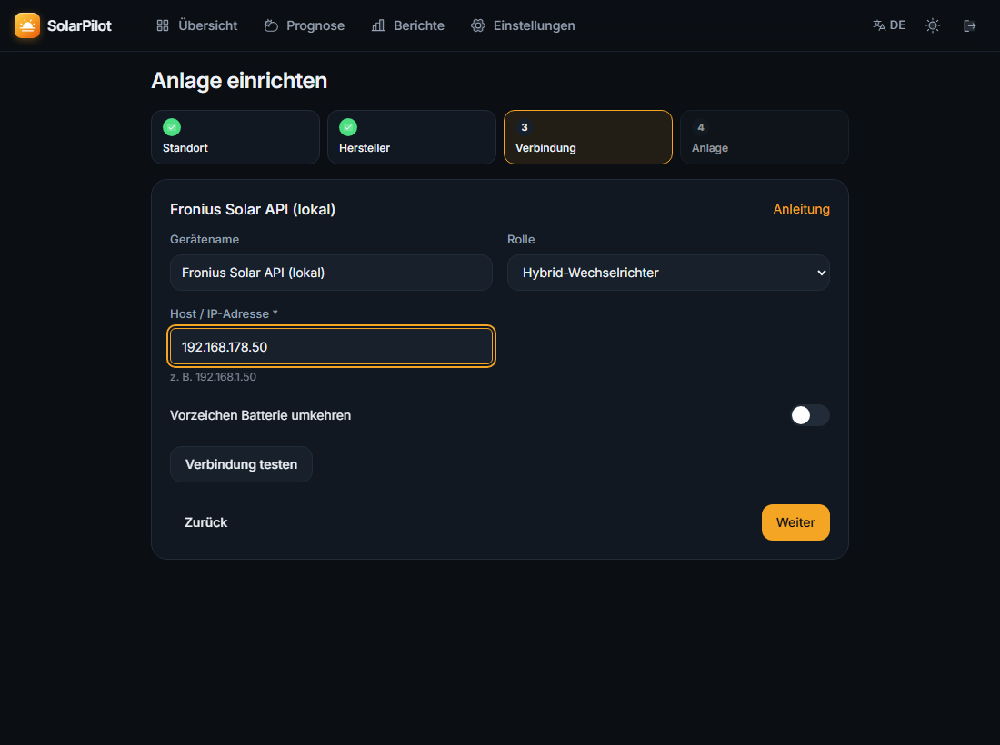
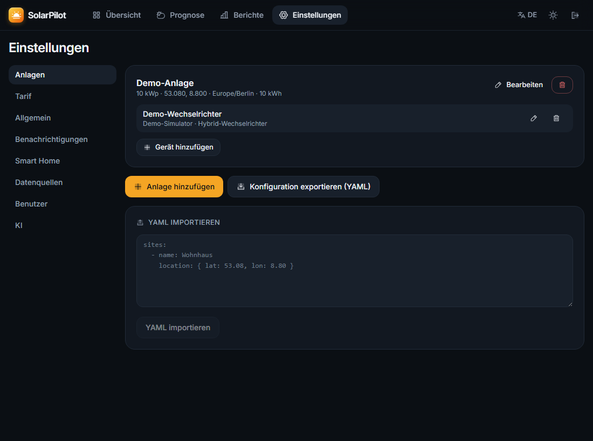
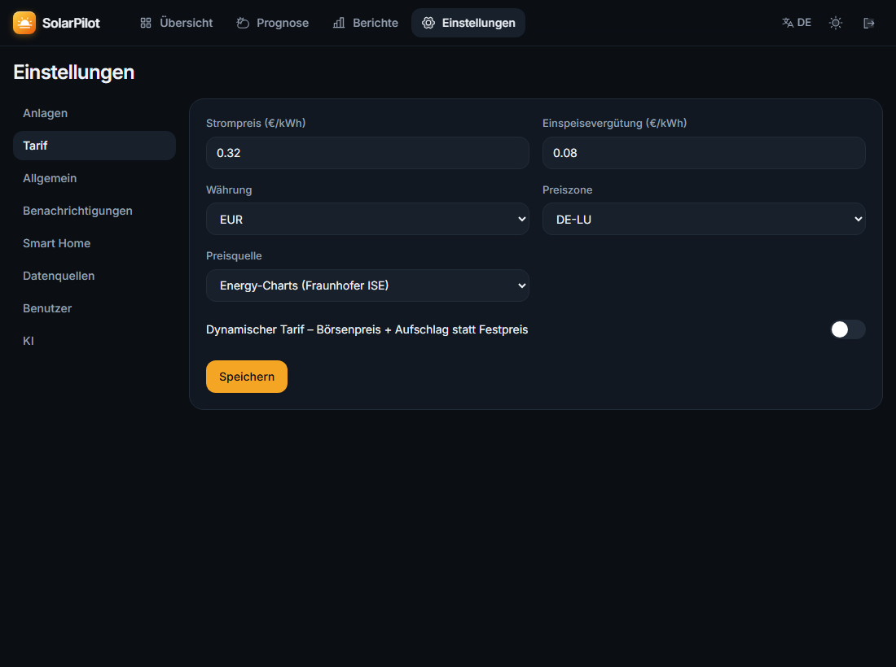
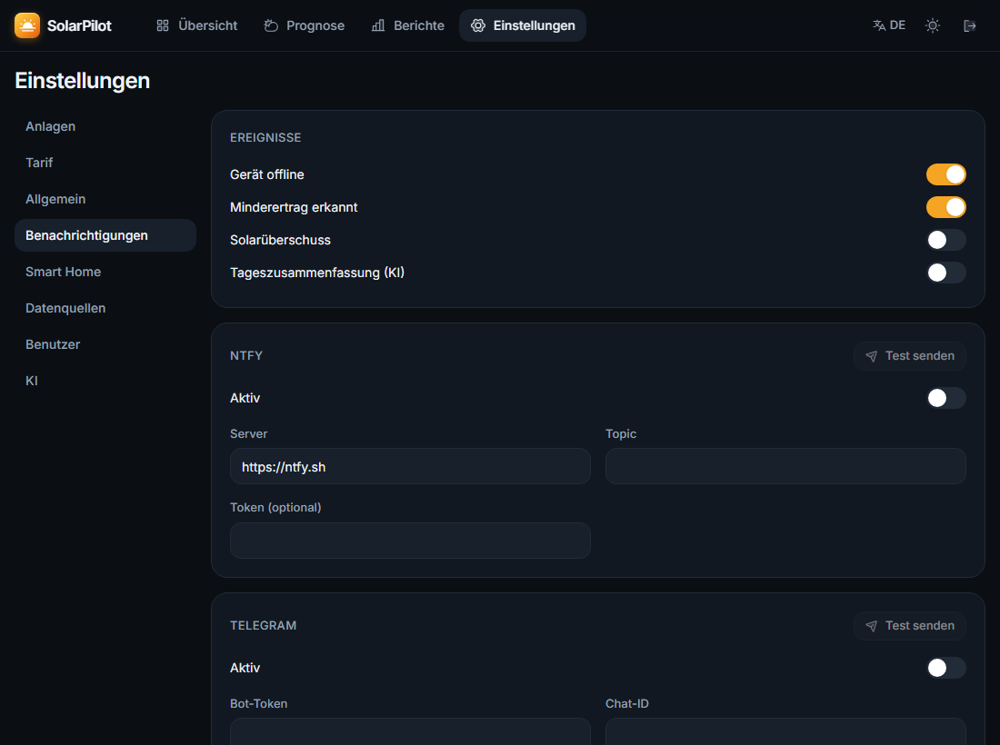
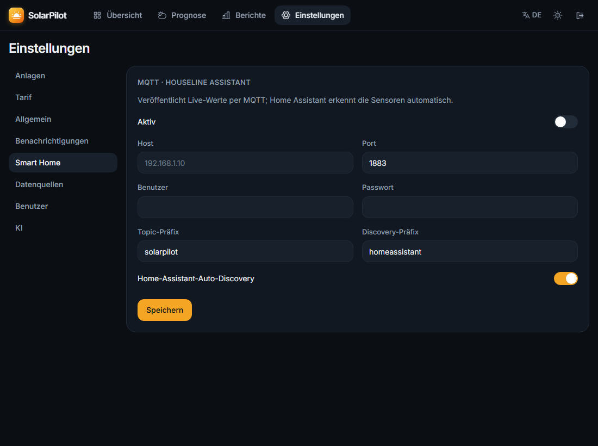

# Erste Schritte

Nach der [Installation](installation.md) richtest du deine Anlage in vier Schritten ein.
Den Assistenten erreichst du über **„Anlage einrichten“** auf der Startseite oder **Einstellungen → Anlagen → Anlage hinzufügen**.

## 1. Standort

Name vergeben, Ort suchen und den Punkt auf der Karte genau setzen. Der Standort wird für Sonnenstand,
Wetter und PV-Prognose gebraucht; die Zeitzone wird automatisch übernommen.

## 2. Hersteller

Hersteller bzw. Verbindungsart wählen. „lokal“ bedeutet direkte Verbindung im Heimnetz (schnell, ohne Cloud).
Die Anleitung zum jeweiligen Gerät findest du unter [Hersteller-Anleitungen](adapters/README.md).

## 3. Verbindung

IP-Adresse und ggf. Zugangsdaten eintragen und **„Verbindung testen“** klicken. Bei Erfolg werden die
aktuellen Werte angezeigt; Zugangsdaten werden verschlüsselt gespeichert.

| Eingabe | Erfolgreicher Test |
| --- | --- |
|  |  |

**Rolle** des Geräts: *Wechselrichter*, *Hybrid-Wechselrichter* (mit Batterie und eigenem Zähler),
*Batterie*, *Netzzähler* (z. B. Shelly 3EM am Hausanschluss – pro Anlage nur einer), *Zähler*, *Wallbox*.

## 4. Anlage

Modulfelder mit Leistung (kWp), Neigung und Ausrichtung eintragen (180° = Süd, 90° = Ost, 270° = West).
Ost/West-Dächer als zwei Felder anlegen. Optional die Batteriekapazität – dann zeigt SolarPilot, wann die
Batterie voll sein wird.

## Weitere Geräte und Anlagen

- Zweites Gerät (z. B. Netzzähler oder Balkonkraftwerk): Assistent → **„Zu bestehender Anlage hinzufügen“**
- Weitere Standorte: einfach eine neue Anlage anlegen – oben im Dashboard erscheint die Auswahl
  inklusive **„Alle Anlagen“**

## Tarif einstellen

Unter **Einstellungen → Tarif** Strompreis und Einspeisevergütung eintragen – daraus berechnet SolarPilot
die Ersparnis. Mit dynamischem Tarif (Tibber, aWATTar, …) zusätzlich „Dynamischer Tarif“ aktivieren und den
Aufschlag (Netzentgelte, Steuern) angeben; die Tipps nutzen dann die Börsenpreise.

## Benachrichtigungen

Unter **Einstellungen → Benachrichtigungen** ntfy, Telegram oder E-Mail einrichten und Ereignisse wählen
(Gerät offline, Minderertrag, Solarüberschuss, Tageszusammenfassung). Mit **„Test senden“** prüfen.

## Home Assistant / MQTT

Unter **Einstellungen → Smart Home** den MQTT-Broker eintragen. Mit aktivierter Auto-Discovery erscheinen
die Sensoren (PV-Leistung, Verbrauch, Netz, Batterie, Ertrag heute) automatisch in Home Assistant und
lassen sich direkt im Energie-Dashboard verwenden.

## Handy-App

SolarPilot ist eine PWA: im Handy-Browser öffnen und **„Zum Startbildschirm hinzufügen“** wählen.

