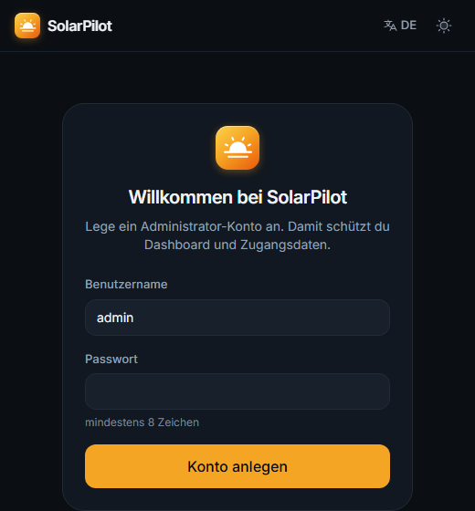

# Installation

SolarPilot läuft überall, wo Docker läuft: Raspberry Pi 4/5 (64 Bit), Synology/QNAP-NAS, Mini-PC,
Windows, macOS oder Linux. Empfohlen: 1 GB RAM, 1 GB freier Speicher.

- [Docker Compose (empfohlen)](#docker-compose-empfohlen)
- [Fertiges Image (Raspberry Pi, NAS)](#fertiges-image-raspberry-pi-nas)
- [Ohne Docker](#ohne-docker)
- [Update, Backup, Fernzugriff](#update)

## Docker Compose (empfohlen)

```bash
git clone https://github.com/solarpilot/solarpilot.git
cd solarpilot
cp .env.example .env          # optional anpassen, z. B. Port
docker compose up -d
```

Danach **http://\<IP-des-Rechners\>:8080** öffnen. Beim ersten Aufruf legst du das Administrator-Konto an:

<p align="center"></p>

Anschließend erscheint der Leerzustand – mit **„Demo starten“** siehst du sofort alle Funktionen mit einer
simulierten Anlage, mit **„Anlage einrichten“** geht es zum [Assistenten](erste-schritte.md).

## Fertiges Image (Raspberry Pi, NAS)

Mit jedem Release wird ein Multi-Arch-Image (amd64 + arm64) in die GitHub Container Registry gebaut:

```bash
docker run -d --name solarpilot --restart unless-stopped \
  -p 8080:8000 -v solarpilot-data:/data \
  ghcr.io/solarpilot/solarpilot:latest
```

Raspberry Pi: Raspberry Pi OS **64 Bit** verwenden und Docker mit `curl -fsSL https://get.docker.com | sh` installieren.
Synology: im Container Manager das Image `ghcr.io/solarpilot/solarpilot` hinzufügen, Port 8080 → 8000 und
einen Ordner auf `/data` mappen.

## Ohne Docker

Voraussetzungen: Python 3.12 und Node.js 22+.

```bash
cd frontend && npm ci && npm run build && cd ..
cd backend && python -m venv .venv && . .venv/bin/activate && pip install -e .
SOLARPILOT_STATIC_DIR=../frontend/out python -m app      # → http://localhost:8000
```

Windows: `scripts\run-local.ps1 -Port 8000`. Als Dienst unter Linux z. B. per systemd-Unit mit
`ExecStart=/opt/solarpilot/backend/.venv/bin/python -m app` und `Environment=SOLARPILOT_STATIC_DIR=/opt/solarpilot/frontend/out`.

## Konfiguration

Alle Einstellungen über Umgebungsvariablen in `.env` (siehe [`.env.example`](../.env.example)):

| Variable | Standard | Bedeutung |
| --- | --- | --- |
| `SOLARPILOT_PORT` | `8080` | Port des Dashboards (Compose) |
| `SOLARPILOT_SECRET_KEY` | automatisch | Schlüssel für Login und Verschlüsselung der Zugangsdaten |
| `SOLARPILOT_DEMO` | `false` | Demo-Anlage beim ersten Start anlegen |
| `SOLARPILOT_POLL_INTERVAL_S` | `10` | Abfrageintervall der Geräte |
| `SOLARPILOT_SITES_FILE` | – | YAML mit Anlagen, siehe [`config/sites.example.yaml`](../config/sites.example.yaml) |
| `SOLARPILOT_DATABASE_URL` | SQLite | z. B. PostgreSQL/TimescaleDB |
| `SOLARPILOT_COOKIE_SECURE` | `false` | hinter HTTPS-Reverse-Proxy auf `true` |
| `SOLARPILOT_RETENTION_DAYS` | `730` | Aufbewahrung der Minutenwerte |

## Update

```bash
git pull && docker compose up -d --build        # aus dem Quellcode
docker pull ghcr.io/solarpilot/solarpilot:latest  # bzw. fertiges Image, dann Container neu starten
```

## Backup

Alles Wichtige liegt im Volume `solarpilot-data` (Datenbank **und** `secret.key`):

```bash
docker run --rm -v solarpilot-data:/data -v "$PWD":/backup alpine tar czf /backup/solarpilot-backup.tgz -C /data .
```

## Fernzugriff

SolarPilot **nicht direkt ins Internet** stellen. Besser: VPN (WireGuard, Tailscale) oder ein Reverse-Proxy
mit TLS (Caddy, Traefik, Nginx Proxy Manager). Für WebSockets muss `/api/ws` mit `Upgrade`-Headern
weitergeleitet werden. Dann `SOLARPILOT_COOKIE_SECURE=true` setzen.

Beispiel Caddy:

```
solar.example.org {
  reverse_proxy 127.0.0.1:8080
}
```

## Passwort vergessen

```bash
docker compose exec -it backend python -m app.cli reset-password admin
```
